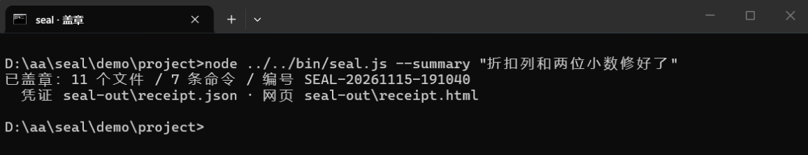
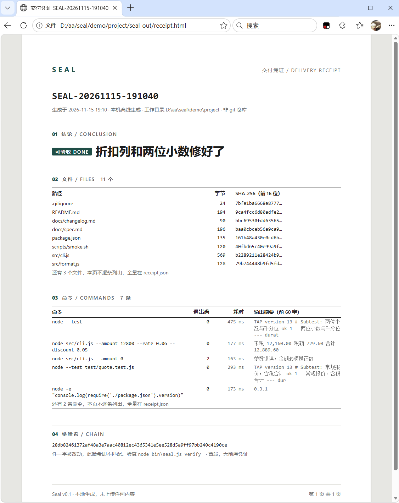
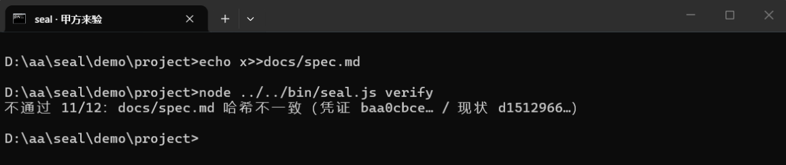

# seal

**给 AI 干的活盖章：一条命令生成可核验的交付凭证，甲方能验，下一个 AI 能接手。**

`License: MIT` · `Node ≥ 18` · `Deps: 0` · `Tests: 41/41`（徽标位先放文字，仓库开通后再换成图）

---

## 问题

- 老板问「做完了吗」，你只能回一句「做完了」，然后他选择信你。
- 换个会话，下一个 AI 完全不知道上一轮改过哪几个文件、跑过什么测试，得从头问一遍。
- 交付物发过去，三天后数字被人动过，谁也说不清是谁改的、什么时候改的。

别的工具都在帮 agent 多做一点，seal 在做的是：**做的这点东西，能被验收。**

## 它做什么

| 命令 | 干什么 | 你会看到 |
|---|---|---|
| `node bin/seal.js` | 盖章：扫当前项目近 30 分钟改过的文件，连同命令记录算成一份凭证 | `seal-out/receipt.json` + `seal-out/receipt.html` |
| `node bin/seal.js run -- <命令>` | 跑一条命令并把完整输出记进 `seal-out/commands.jsonl`（`seal -- <命令>` 等价） | 命令自己的输出 + `已记录：…` |
| `node bin/seal.js verify` | 验真：重算链哈希、逐个文件哈希；凭证里标了 `recheck` 的命令只列出来，**默认不执行** | `通过 12/12 …` 或 `不通过 11/12：…`，退出码 0 / 1 |
| `node bin/seal.js verify --allow-run` | 连同 `recheck` 命令一起真跑（命令含危险字符会提示） | `$ <命令>` + 退出码与输出指纹比对结果 |
| `node bin/seal.js keygen` | 生成 ed25519 密钥（`~/.seal/key.json` + 可直接发人的 `pubkey.json`）；已有则不覆盖，`--force` 才覆盖 | 指纹 + 公钥路径 |
| `node bin/seal.js trust <公钥文件>` | 把甲方/对方的公钥加进 `~/.seal/trusted.json`；`trust --list` 看清单 | `已加入信任列表：<指纹>` |
| `node bin/seal.js anchor` | 把 `chain.hash` 写成 `seal-out/ANCHOR` 并提交成一条 git commit（只本地，**不 push**） | `已锚定：commit ab12cd3，时间 …，hash …` |
| `node bin/seal.js resume` | 接管：把凭证翻译成一份人话简报，下一个会话（或下一个人）直接接着干 | 改了哪些文件 / 验过什么 / 下一步 |
| `node bin/seal.js show` | 用默认浏览器打开 `receipt.html`；打不开就把路径打出来 | 一页 A4 凭证 |
| `node bin/seal.js help` | 打印用法 | 上面几行 |

盖章时可选：`--summary "一句话结论"`、`--status done|partial|blocked`、`--todo "下一步"`、`--prev 上一份凭证的哈希`（串成链）、`--window 分钟`（默认 30）。

## 30 秒上手

需要 Node 18+，不用装任何依赖。下面整段可以直接粘进 cmd 跑，只需改前两行：

```bat
:: 只改这两行：SEAL = 你机器上 bin\seal.js 的路径；cd 的目标 = 要交付的项目
set SEAL=D:\aa\seal\bin\seal.js
cd /d D:\work\my-project

:: 1. 跑一条命令，把完整输出记进 commands.jsonl（这一步可选）
node %SEAL% run -- npm test

:: 2. 盖章（扫近 30 分钟改过的文件 + commands.jsonl 里的命令记录）
node %SEAL%

:: 3. 验真（通过退出码 0，不通过退出码 1）
node %SEAL% verify

:: 4. 把凭证那一页打开给甲方看
node %SEAL% show
```

真跑出来是这样（`docs/shots/01-seal.png`）：



## 凭证里有什么

1. **改了什么**——每个文件的路径、字节数、SHA-256（流式算的，文件多大都不读进内存）。
2. **跑过什么**——命令、退出码、耗时、输出的哈希，外加输出前 200 字留档。
3. **结论**——一句话 summary，加 `done` / `partial` / `blocked` 三档状态。
4. **链哈希**——整份凭证的 SHA-256；传 `--prev` 时和上一份凭证的哈希串起来，改中间任意一份，后面全对不上。
5. **能重跑验收**——`commands.jsonl` 里标了 `"recheck": true` 的命令（`seal run --recheck -- <命令>` 会自动标），`verify --allow-run` 会真跑一遍，比对退出码和输出哈希，不是只看记录。**默认不执行**：凭证是别人发来的输入，不能一验就跑代码。

凭证同时给两份：`receipt.json`（可验）和 `receipt.html`（A4 一页，可直接打印或发人）。

> 入库建议：`receipt.json` 建议入库；`commands.jsonl` 不建议入库（可能含输出片段）。



> 采集范围说清楚：只登记**近 30 分钟内改动过**的文件（`--window` 可调），跳过 `node_modules`、`.git`、`seal-out`。它记的是「这次交付动了什么」，不是「仓库里有什么」。窗口外但 24 小时内改过的文件不会被静默丢掉——盖章时会打一行「注意：另有 N 个文件超出 30 分钟窗口未收录」，同时写进凭证的 `warnings`。什么都没采到时直接拒绝出凭证（退出码 2）。

## 让「防篡改」成立：签名 + 时间锚

`chain.hash` 是**无密钥**的 sha256——算法公开，谁都能把整份凭证重写一遍再重算哈希。所以要挡住这一手，必须有一方不是你自己：

```bat
node %SEAL% keygen                          :: 1. 生成 ed25519 密钥（~/.seal/key.json）
node %SEAL%                                 :: 2. 盖章，凭证里自动带 sig
node %SEAL% trust D:\某个\pubkey.json        :: 3. 甲方把公钥加进信任列表（甲方机器上跑）
node %SEAL% verify                          :: 4. 甲方验，才知道「谁签的、签完有没有被改」
node %SEAL% anchor                          :: 5.（可选）把 chain.hash 锚进一条 git 提交
```

**签名口径（固定，别改）**：签名对象是 `chain.hash` 的 UTF-8 字节；算法 `ed25519`；公钥指纹 = `sha256(公钥 DER/SPKI)` 前 16 位。凭证里的字段是 `sig: { alg, pub_fpr, value(base64) }`。

`verify` 会给三档互不混淆的结论：

| 情况 | 输出 |
|---|---|
| 没有 `sig` | `未签名：任何人可重算此凭证（当前结论不构成防抵赖）` |
| 有 `sig`，公钥不在信任列表 | `已签名，但公钥未被信任（用 seal trust <pubkey 文件> 加入）` |
| 有 `sig`，公钥已信任且验签通过 | `已签名并验证通过（签名者指纹 …）` |
| 有 `sig` 但验签失败 | `签名不匹配：凭证被改过`（退出码 1） |

`anchor` 只写 `seal-out/ANCHOR`（一行 `<编号> <chain.hash>`）并提交这一条路径，提交信息 `seal anchor <编号> <hash 前 12 位>`。**它不会 push**——推送之后，这个时间点才真正落到别人手里，无法再改。

> 签名能证明的是「这份凭证是你签的、签完之后没被改」，不能证明「你写的内容是真的」。未 `trust` 之前，「有签名」不等于「可信」。

## 它跟别的不一样在哪

- **日志 ≠ 凭证。** 日志是给自己看的流水，一行一条，谁都能写；凭证是给甲方看的结论加可验指纹，改一个字就验不过。
- **截图 ≠ 可验。** 截图能 P、能截一半。`verify` 是当场重算哈希，不是读你写的说明。
- **聊天记录 ≠ 能接手。** 接手的人不想翻 200 条消息，他想要「改了 11 个文件、7 条命令、下一步是什么」这样一页。

改一个字节之后就是这样（`docs/shots/03-verify-fail.png`）：



## 它不管什么

- **不做云端。** 没有账号、没有上传、不联网。凭证就是你项目里那两个文件，删了就没了。
- **不替代测试。** 它只记录你跑过什么、跑出什么，不判断这些测试够不够。
- **不保证代码对。** 哈希证明「没变过」，不证明「写得对」。
- **不防一开始就撒谎。** 盖章那一刻你写什么就是什么；它防的是盖章**之后**被改，不是盖章之前吹牛。

---

## English

**What it is.** Seal the work your agent did — one command produces a verifiable delivery receipt your client can check and the next agent can resume from. Zero dependencies, one file, works offline on Node 18+.

**The problem.** "Is it done?" — right now the only answer is "yes, trust me". A new session has no memory of which files changed or which tests ran. And once the deliverable is sent, nobody can tell if a number was edited afterwards.

**What it does.** `seal` hashes every file changed in the last 30 minutes (`--window` to widen) plus the command log in `seal-out/commands.jsonl`, then writes `receipt.json` and a one-page `receipt.html`. `seal run -- <cmd>` executes a command, streams its output and records it. `verify` recomputes the chain hash and re-hashes every file; commands marked `"recheck": true` are **listed but not executed** — `--allow-run` actually re-runs them and compares exit code and output hash. `resume` prints a short handover brief; `show` opens the receipt page.

**What's inside.** Changed files with path, size and SHA-256; commands with exit code, duration and output fingerprint; a one-line conclusion with `done` / `partial` / `blocked`; a chain hash linking this receipt to the previous one.

**Why not just logs or screenshots.** Logs are private notes, screenshots can be edited, and chat history is not a handover. A receipt is a conclusion plus fingerprints that anyone can re-check in one command — and it fails loudly the moment one byte changes.

**What it does not do.** No cloud, no account, no upload. It does not replace your tests, does not prove the code is correct, and cannot stop you from overstating things at the moment you sign.

## Roadmap

- **MCP server**——让 agent 在会话里直接盖章、验真，不用手敲命令。
- **GitHub Action**——PR 上自动贴一份凭证，reviewer 先看凭证再看 diff。
- **团队版**——同一项目多份凭证串一条链，谁盖的、什么时候盖的，一眼看到。

以上三项都还没做，写完一版才会从这行挪走。
